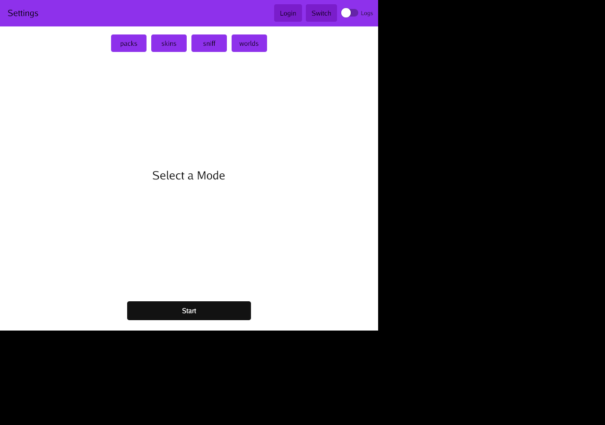
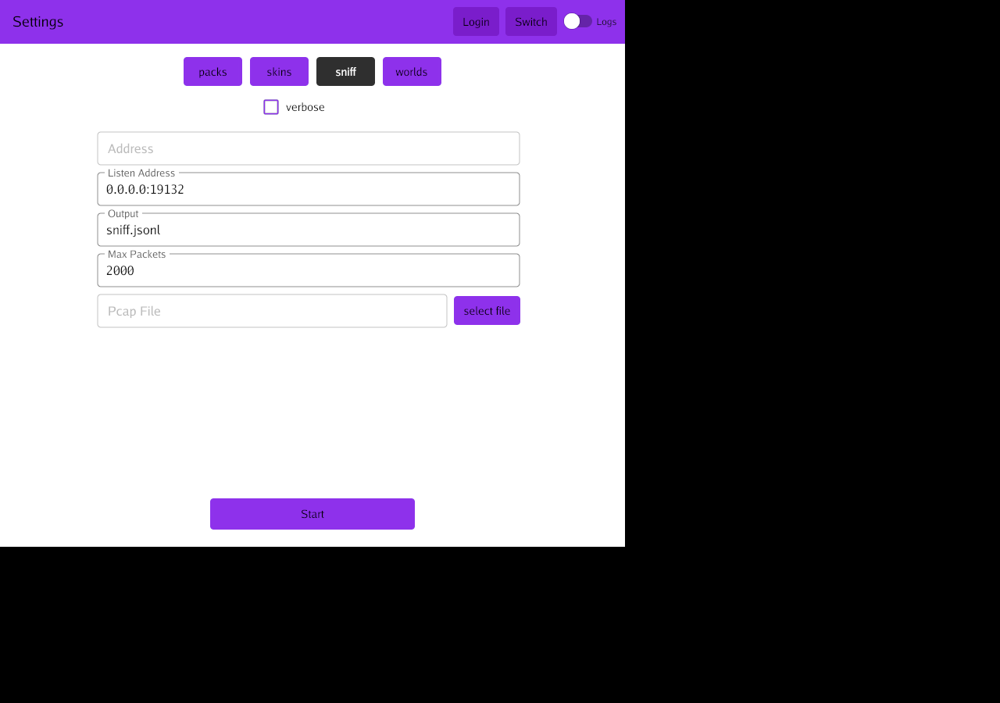
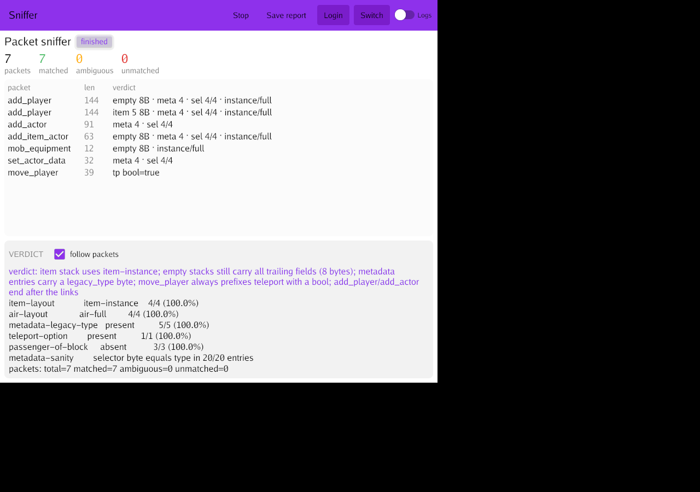

# bedrocktool 抓包工具 GUI 使用指南

分支：`feat/packet-sniffer`（fork `fengyushaonian/bedrocktool`，提交 `f630057`）
用途：判定 1001 / 2168 / 2193 之间那几个"文档说不清"的线格式——物品栈、metadata 选择子、teleport 前缀。

---

## 一、这次改了什么

`sniff` 之前只有命令行。现在 GUI 版里多了一个 `sniff` 模式，整个流程都在一个窗口里：



新增的能力：

| 位置 | 变化 |
| --- | --- |
| 设置页 | 模式按钮从 3 个变 4 个：`packs` `skins` `sniff` `worlds` |
| Sniffer 页 | 实时计数（总数 / 命中 / 歧义 / 无匹配）+ 每帧一行的表格 + 结论面板 |
| 顶栏 | `Stop` 停止抓包、`Save report` 导出结论 |
| 文件选择 | 只显示 `.pcap2`，避免选错文件 |

> 之所以值得做：判定结果是"哪个假设刚好消费完这一帧"，用日志刷屏时根本看不出比例。表格里每帧一行、按结果着色，异常帧一眼可见。

---

## 二、编译

GUI 用 gio，需要 CGO。**不编译 gui 标签就只有命令行版**，`sniff` 仍然可用。

先取代码（子模块是 gophertunnel，必须拉）：

```bash
git clone https://github.com/fengyushaonian/bedrocktool.git
cd bedrocktool
git checkout feat/packet-sniffer
git submodule update --init --depth 1
```

### Windows

需要 Go 1.26+ 和 gcc（gio 的 Windows 后端用 CGO）：

```powershell
winget install GoLang.Go
winget install BrechtSanders.WinLibs.POSIX.UCRT   # 提供 gcc，装完把它的 bin 加进 PATH
$env:CGO_ENABLED=1
go build -tags gui -o bedrocktool.exe ./cmd/bedrocktool
```

验证 gcc：`gcc --version` 能出版本号即可。

### Linux

```bash
sudo apt update
sudo apt install -y gcc libgl1-mesa-dev libx11-dev libx11-xcb-dev \
  libxkbcommon-x11-dev libxfixes-dev libxcursor-dev libxrandr-dev \
  libxinerama-dev libxi-dev libvulkan-dev libwayland-dev
go build -tags gui -o bedrocktool ./cmd/bedrocktool
```

缺 `vulkan/vulkan.h` 就是漏了 `libvulkan-dev`；缺 `xkbcommon-x11` 就是漏了 `libxkbcommon-x11-dev`。

### macOS

```bash
xcode-select --install
go build -tags gui -o bedrocktool ./cmd/bedrocktool
```

---

## 三、启动

```bash
./bedrocktool            # 不带参数 = GUI
./bedrocktool sniff -h   # 带参数 = 命令行
```

不带参数才会进图形界面，这是程序原本的规则。

---

## 四、离线分析（建议先做这一步）

不需要账号、不需要服务器，几秒钟出结果。

1. 启动 GUI，停在 `Settings` 页。
2. 点 **`sniff`** 按钮。
3. `Pcap File` → 点右侧 **`select file`**，选一个 `.pcap2`。
4. `Address` 留空（离线模式不需要）。
5. 点底部 **`Start`**。



表单各项含义：

| 字段 | 说明 | 离线时 |
| --- | --- | --- |
| `Address` | 要代理的真实服务器 `host:port` | 留空 |
| `Listen Address` | 本机监听地址，默认 `0.0.0.0:19132` | 不用管 |
| `Output` | 每帧一条 JSON 的落盘文件，默认 `sniff.jsonl` | 建议填绝对路径 |
| `Max Packets` | 最多处理多少帧，`0` = 不限，默认 2000 | 想全量就填 `0` |
| `verbose` | 勾上后额外记录每个候选假设 | 排查时勾 |
| `Pcap File` | 离线分析的抓包文件 | 必填 |

怎么先拿到一个 `.pcap2`：GUI 里跑 `worlds`/`packs`/`skins` 模式（表单里的 `capture` 默认勾选），进一次服务器，文件会落在 **`captures/<服务器名>-<时间>.pcap2`**；或者命令行：

```bash
./bedrocktool capture -address play.example.com:19132
```

---

## 五、实时抓包

1. `Address` 填真实服务器：`play.example.com:19132`。
2. `Listen Address` 默认 `0.0.0.0:19132`。**如果本机已经开了 BDS 占用 19132，改成 `0.0.0.0:19133`**。
3. 点 `Start`，页面切到 `Sniffer`，顶部显示：


4. 客户端（基岩版）→ 多人游戏 → 添加服务器 → 地址填 **`127.0.0.1:19132`**（客户端和服务端在同一台机器）或代理机器的内网 IP。
5. 进世界。帧开始流入表格。

> 首次使用会弹出微软账号登录（代理要用自己的账号连真实服务器）。登录完成后代理才开始转发。

---

## 六、读结果



**顶部四个数字**

| 名称 | 含义 |
| --- | --- |
| `packets` | 已探测的帧数 |
| `matched` | 只有一种解释能刚好消费完整帧 → 有投票权 |
| `ambiguous` | 多种解释都能消费完整帧 → 只计数，不改结论 |
| `unmatched` | 没有任何解释能消费完整帧 → 通常是未知字段或解析器还没覆盖的版本 |

**表格三列**：包名、字节长度、判定结论。判定文本是压缩过的，例如：

```
empty 8B · meta 4 · sel 4/4 · instance/full
item 5 8B · meta 4 · sel 4/4 · instance/full
```

- `empty 8B` / `item 5 8B`：这个物品字段占了几字节、网络 id 是多少。
- `meta 4`：4 条 metadata。
- `sel 4/4`：4 条 metadata 的选择子字节全都等于 `type`（原版就是这么校验的，不等直接判假）。
- `instance/full`：物品布局判定为 `ItemInstance`（定长 int16 id），且空物品仍写满尾部字段。
- `tp bool=true`：`move_player` 的 teleport 体带有 bool 前缀。

颜色：正常色 = 唯一命中，**琥珀色 = 歧义**，**红色 = 无匹配**。

**底部结论面板**：`verdict:` 一行是总结，下面按维度给出命中比例：

```
verdict: item stack uses item-instance; empty stacks still carry all trailing fields (8 bytes); ...
item-layout            item-instance    4/4 (100.0%)
air-layout             air-full         4/4 (100.0%)
metadata-legacy-type   present          5/5 (100.0%)
teleport-option        present          1/1 (100.0%)
passenger-of-block     absent           3/3 (100.0%)
metadata-sanity        selector byte equals type in 20/20 entries
packets: total=7 matched=7 ambiguous=0 unmatched=0
```

如果某个维度不是 100%（例如 `air-layout 12/14`），说明抓包里混了两个版本的帧，或者解析器还有读错的地方——勾 `verbose` 重跑，看那两帧的所有候选。

**导出**：顶栏 `Save report`，写到 `sniff-report-<时间>.txt`，路径会显示在结论面板里。

---

## 七、输出文件

| 文件 | 内容 |
| --- | --- |
| `sniff.jsonl` | 每帧一条 JSON：包号、长度、判定、事实、hex、全部候选 |
| `sniff.jsonl.summary.txt` | 汇总结论（命令行模式） |
| `<pcap>.verdict.txt` | 离线模式写在抓包文件旁边 |
| `sniff-report-<时间>.txt` | 界面里 `Save report` 导出的 |

`Output` 填相对路径时落在程序当前工作目录，**建议直接填绝对路径**，省得找。

---

## 八、排错

| 现象 | 原因 / 处理 |
| --- | --- |
| 点 `Start` 弹 `no address given` | 实时模式没填 `Address`，也没有选 `Pcap File` |
| `Listen Address` 启动失败 | 19132 被占用了，改 `0.0.0.0:19133`，客户端连 19133 |
| 一直 `Waiting for packets` | 客户端没连上代理端口，或还没进世界；确认客户端里填的是 `127.0.0.1:19132` |
| 全是红色 `no match` | 抓的是别的版本的包，或该包有解析器没覆盖的字段；勾 `verbose` 看"best"卡在哪一字节 |
| `packets` 涨到 2000 就停 | `Max Packets` 到了上限，改成 `0` 或更大 |
| 编译报 `vulkan/vulkan.h` | `sudo apt install libvulkan-dev` |
| 编译报 `xkbcommon-x11` | `sudo apt install libxkbcommon-x11-dev libx11-xcb-dev` |
| Windows 编译报 `gcc not found` | 装 WinLibs 并把 `bin` 加进 PATH，确认 `CGO_ENABLED=1` |
| 界面里没有 `sniff` 按钮 | 编译时漏了 `-tags gui`，跑的是命令行版 |

---

## 九、直接用命令行（不开 GUI）

功能完全一样，只是没有表格：

```bash
# 离线
./bedrocktool sniff -pcap captures/server.pcap2 -out sniff.jsonl -max 0

# 实时
./bedrocktool sniff -address play.example.com:19132 -listen 0.0.0.0:19133 -out sniff.jsonl
```
